<!-- ═════════════ HEADER ═════════════ -->
<p align="center">
  
</p>

<p align="center">
  <a href="https://linkedin.com/in/sabnira-afrin"></a>
  <a href="https://github.com/sabnira"></a>
  <a href="https://pawshome-5ed4f.web.app/"></a>
  <a href="https://electrafix-98f49.web.app/"></a>
</p>

<p align="center">
  
  
  
  
</p>

<p align="center"></p>

## ⚡ About Me

> 💛 I help turn ideas and designs into responsive, user-friendly web applications that look great and work smoothly across devices. Whether you need a polished frontend or a complete web application, I focus on clean code, thoughtful UI, and a seamless user experience.
>
> I work primarily with React and modern frontend technologies, with hands-on experience building REST APIs, authentication systems, database integrations, and full-stack applications.

```js
const sabnira = {
  role: "Frontend-Focused Full Stack Developer",
  education: "B.Sc. in Computer Science and Engineering",
  location: "Chattogram, Bangladesh",

  services: [
    "Responsive website development",
    "Custom React UI development",
    "Full-stack web applications",
    "API and authentication integration",
  ],

  stack: [
    "React",
    "JavaScript",
    "Tailwind CSS",
    "Node.js",
    "Express",
    "MongoDB",
  ],

  focus: "Responsive UI, clean code, and seamless user experiences",

  openTo: [
    "Freelance Projects",
    "Remote Opportunities",
    "Collaborations",
  ],
};
```

| | |
| :-- | :-- |
| 🎓 **Education** | B.Sc. in Computer Science and Engineering |
| 💻 **Specialization** | React Frontend Development & MERN Stack |
| 🎨 **What I Build** | Responsive websites, custom UI, and web applications |
| 🌟 **My Approach** | Clean code, user-friendly design, and maintainable solutions |
| 📍 **Location** | Chattogram, Bangladesh |

<p align="center"></p>

## 🛠️ Tech Stack

**🎨 Frontend Development**


**⚙️ Backend & Database**


**🔐 Authentication, Payments & Tools**


<p align="center"></p>

## 🌟 Featured Projects

<table>
  <tr>
    <td width="50%" valign="top">
      <h3>🐾 <a href="https://github.com/sabnira/pawshome">PawsHome</a></h3>
      <p>A pet adoption platform designed to make finding and adopting pets easier. Includes searchable pet listings, category filters, secure authentication, dedicated dashboard and an intuitive adoption experience.</p>
      <p><b>Stack:</b> React · Node.js · Express · MongoDB · Firebase</p>
      <p>
        <a href="https://pawshome-5ed4f.web.app/"></a>
        <a href="https://github.com/sabnira/pawshome"></a>
      </p>
    </td>
    <td width="50%" valign="top">
      <h3>🔧 <a href="https://github.com/sabnira/electrafix">ElectraFix</a></h3>
      <p>A service booking platform that helps customers find repair services and manage bookings. Includes service listings, secure accounts, booking management, and status tracking for service providers.</p>
      <p><b>Stack:</b> React · Node.js · Express · MongoDB · Firebase · JWT</p>
      <p>
        <a href="https://electrafix-98f49.web.app/"></a>
        <a href="https://github.com/sabnira/electrafix"></a>
      </p>
    </td>
  </tr>
  <tr>
    <td width="50%" valign="top">
      <h3>🍽️ <a href="https://github.com/sabnira/meal-restaurant">Meal Restaurant</a></h3>
      <p>A restaurant ordering solution that streamlines online food orders and payments. Includes Stripe checkout integration and separate dashboards for customers and administrators.</p>
      <p><b>Stack:</b> React · Node.js · Express · MongoDB · Stripe</p>
      <p>
        <a href="https://github.com/sabnira/meal-restaurant"></a>
      </p>
    </td>
    <td width="50%" valign="top">
      <h3>🎬 <a href="https://github.com/sabnira/cinescope">CineScope</a></h3>
      <p>A movie discovery application that makes it easy to explore, search, and save favorite movies through an interactive interface.</p>
      <p><b>Stack:</b> React · REST API</p>
      <p>
        <a href="https://github.com/sabnira/cinescope"></a>
      </p>
    </td>
  </tr>
</table>

<p align="center"></p>

## ✨ Project Highlights

<details>
<summary><b>🐾 PawsHome — Features & Functionality</b></summary>
<br/>

- ⚡ Responsive pet listing interface with **infinite scrolling** and MongoDB-backed pagination
- ⚡ **Debounced search** and category filters to help users find relevant pets faster
- ⚡ Firebase Authentication with email/password, Google, and Facebook sign-in
- ⚡ User-friendly login forms with react-hook-form and captcha validation
- ⚡ JWT-secured API requests through reusable Axios hooks
- ⚡ Responsive UI built with Tailwind CSS and DaisyUI
- ⚡ Deployed on Firebase Hosting

</details>

<details>
<summary><b>🔧 ElectraFix — Features & Functionality</b></summary>
<br/>

- ⚡ Secure authentication with email/password and Google login
- ⚡ JWT-protected private routes for authenticated users
- ⚡ Service marketplace where providers can add, edit, and delete their own listings
- ⚡ Dedicated dashboards for managing services and customer bookings
- ⚡ Booking workflow with status updates: `pending → working → completed`
- ⚡ Real-time service search to help users find what they need
- ⚡ Dark/light theme toggle and Framer Motion animations
- ⚡ Persistent login, protected credentials, and production deployment

</details>

<details>
<summary><b>🍽️ Meal Restaurant — Features & Functionality</b></summary>
<br/>

- ⚡ Online food ordering and checkout experience
- ⚡ Stripe payment integration
- ⚡ Separate admin and customer dashboards
- ⚡ Full-stack application built with React, Node.js, Express, and MongoDB

</details>

<p align="center"></p>

## 💼 What I Can Help You With

| Service | How I Can Help |
| :-- | :-- |
| 🎨 **Figma to React** | Turn your Figma designs into clean, responsive React interfaces. |
| 📱 **Responsive Websites** | Build websites that work smoothly across mobile, tablet, and desktop. |
| ⚛️ **Custom React UI** | Develop reusable components and interactive interfaces tailored to your project. |
| 🔗 **API Integration** | Connect your frontend with backend services and third-party APIs. |
| 🔐 **Authentication** | Implement login, registration, social authentication, and protected routes. |
| ⚙️ **Full-Stack Development** | Build functional web applications using React, Node.js, Express, and MongoDB. |
| 💳 **Payment Integration** | Add Stripe-powered checkout and payment functionality. |
| 🛠️ **Website Improvements** | Fix UI issues, improve existing components, and make interfaces responsive. |

<p align="center"></p>

## 🤝 Let's Work Together

Have a website idea, a Figma design, or an existing project that needs improvement?

I can help you turn it into a responsive, functional, and user-friendly web experience with clean, maintainable code.

I'm open to freelance projects, remote opportunities, and collaborations.

**Let's bring your next web project to life!** 💛

<p align="center">
  <a href="https://linkedin.com/in/sabnira-afrin"></a>
  <a href="https://github.com/sabnira"></a>
</p>

<p align="center"><i>Thanks for visiting! ⭐ If you find my work useful, consider starring a repository.</i></p>

<p align="center"></p>
